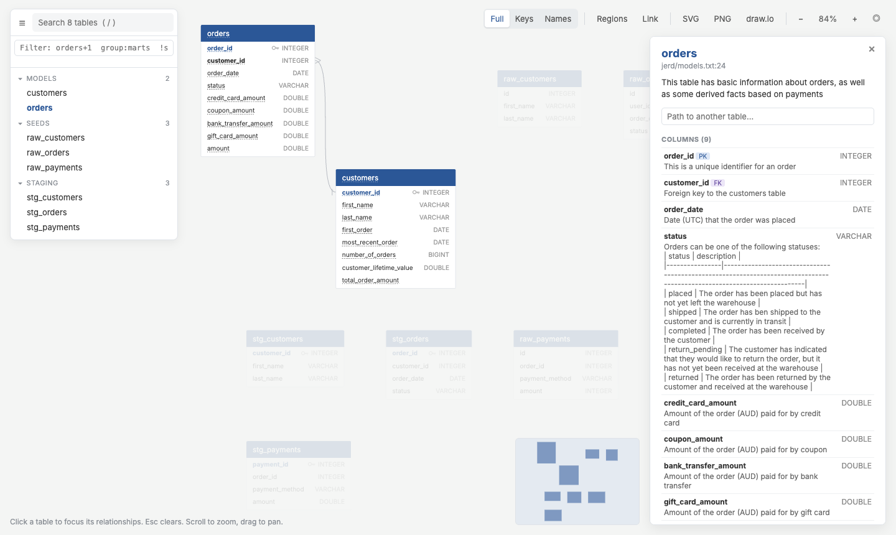

# 2. Explore the model

## Open it

```bash
qdbd serve erd/
```

{ .shot }

The explorer groups tables by dbt folder: **models**, **seeds**, **staging**. Clicking `orders` opens its details:

- the model description and every column's description;
- `customer_id` is tagged **FK**; under **References** it points to `customers.customer_id` (N:1);
- under `customers`, **Referenced by** lists `orders.customer_id`.

## Arrange it

Drag `customers` next to `orders`. The position is saved to `erd/qdbd.layout.json`. Commit that file and everyone sees the same arrangement.

To keep each dbt folder together with shaded regions:

```bash
qdbd layout erd/ --by-group
```

## Narrow it down

In the explorer's filter box (or with `-s` on the CLI):

| Filter | Shows |
|---|---|
| `group:models` | only the marts |
| `+orders` | `orders` and what it references |
| `customers+` | `customers` and what references it |
| `col:customer_id` | every table with a `customer_id` column |
| `!group:seeds` | everything except seeds |

## How do two tables join?

In `orders`' details, type `customers` into **Path to another table**:

```text
orders -> customers: 1 join(s)
  orders.customer_id -> customers.customer_id (N:1)

FROM orders
JOIN customers ON customers.customer_id = orders.customer_id
```

The same from the terminal:

```bash
qdbd path erd/ --from orders --to customers
```

## Share a view

Select `orders`, filter `+orders`, then press **Link**. The copied URL reopens exactly that view, so you can paste it in Slack or a ticket.

[Next: review a change :octicons-arrow-right-24:](review.md){ .md-button }
