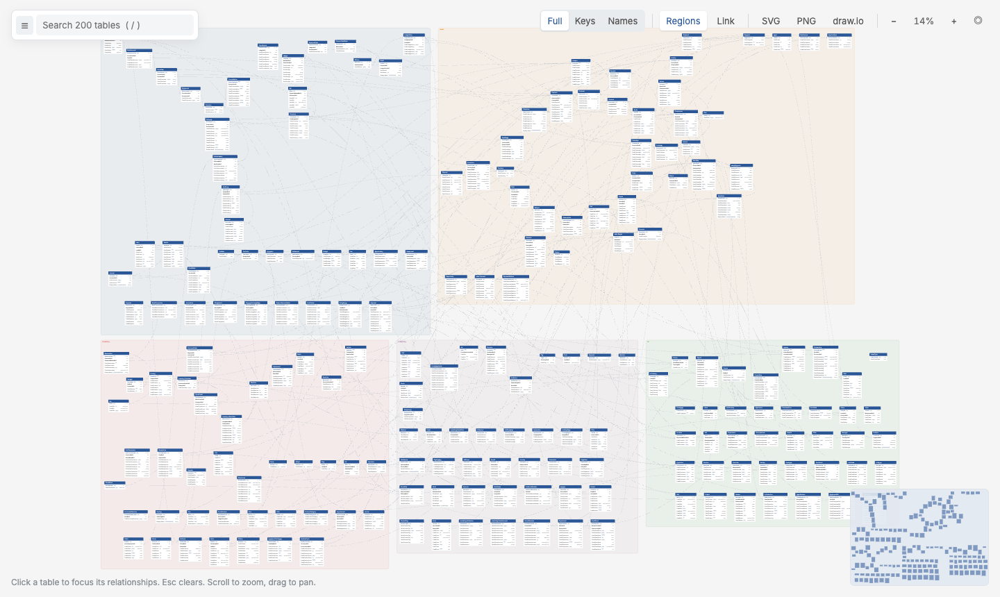

# 3.2 Many Files, One Diagram

Big schemas are easier to manage split into files, one per area or team. Point any command at a folder and every `*.txt` under it, recursively, becomes **one** diagram:

```text
schema/
├── sales.txt        # Order, OrderLine, Invoice …
├── customers.txt    # Customer, Address …
└── products/
    └── catalog.txt
```

```bash
qdbd check schema/
qdbd serve schema/
qdbd build schema/ -o schema.html
```

You can also list files: `qdbd build sales.txt customers.txt -o sales.html`.

## How the files combine

- **One namespace:** foreign keys can point at tables in other files. Defining the same table in two files is an error that names both locations.
- **Settings stay per file:** `CaseSensitive` and `DefaultFieldType` apply to the file that sets them, so each file still pastes into QuickDBD on its own.
- **One layout file:** positions for the whole folder go to `schema/qdbd.layout.json` ([3.3 Table Positions](layout.md)).

## Files become groups

Each file is a **group**. In the page:

- the explorer lists tables under their file;
- **Regions** shades a labelled area per file ([4.1](reading-the-diagram.md#regions));
- the selector `group:sales` or `file:sales.txt` filters to one file ([4.2](selectors.md)).

To arrange the diagram so each file's tables sit together, add `--by-group`:

```bash
qdbd build schema/ --by-group -o schema.html
```

{ .shot }
