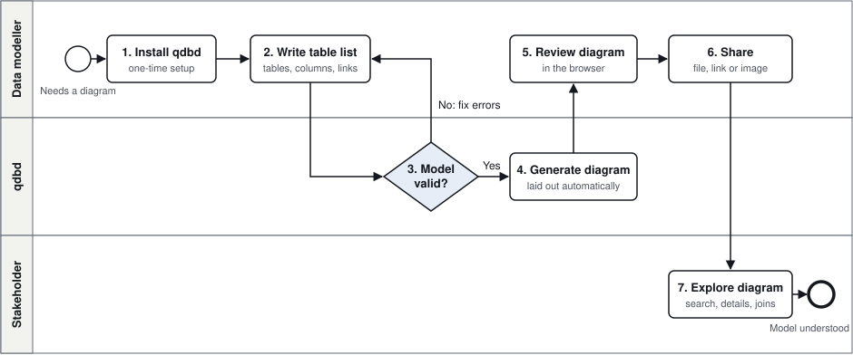
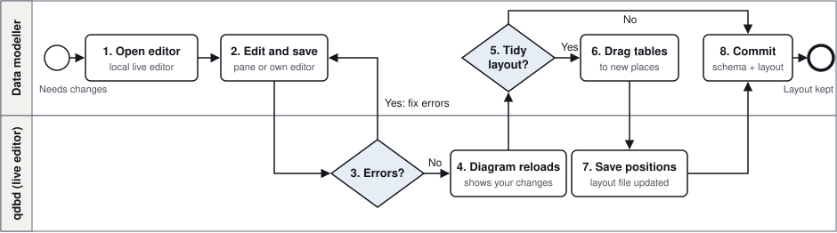
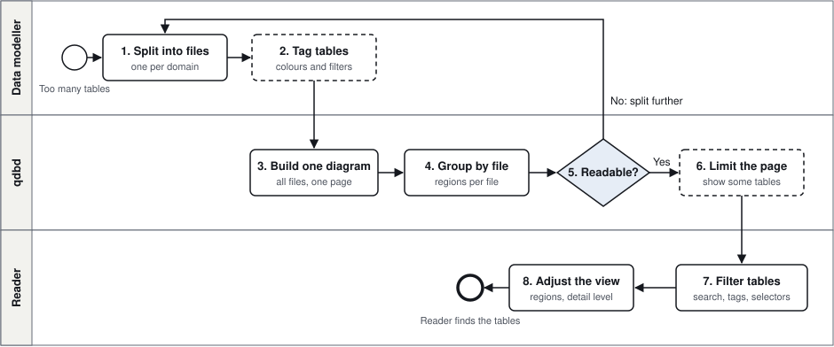
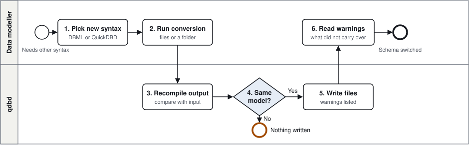

# 10.2 Build the Model

These four flows take you from an empty folder to a diagram you can edit, organise and convert. Back to [all flows](index.md).

## 1. First Diagram { #first-diagram }

**Who:** Data modeller, Stakeholder · **Starts when:** Someone needs a picture of the data model · **Outcome:** A diagram the stakeholder can explore

[{ .flow }](../assets/img/flows/01-first-diagram.svg)

| # | Step | Who | What happens |
|---|---|---|---|
| 1 | Install qdbd | Data modeller | One-time install with pip, pipx or uv (`pip install quickdbd-cli`). Viewers install nothing. |
| 2 | Write table list | Data modeller | Tables, columns and links in a `.txt` (QuickDBD syntax) or `.dbml` file, or imported from dbt (flow 11). |
| 3 | Model valid? | qdbd | `qdbd check erd/` names file, line and reason for each error. Fix and check again. |
| 4 | Generate diagram | qdbd | `qdbd build erd/ -o diagram.html` lays out every table and writes one HTML file. |
| 5 | Review diagram | Data modeller | Open the file in a browser. |
| 6 | Share | Data modeller | Send the file, a link or an image (flows 9 and 10). |
| 7 | Explore diagram | Stakeholder | Search, open details, find join paths (flow 8). |

- The HTML file is self-contained and works offline.
- Editing live in a browser is covered in flow 2.

More: [Install](../install.md), [Quick Start](../getting-started.md#check-it), [Reading the Diagram](../reading-the-diagram.md)

## 2. Edit Live and Arrange Tables { #live-edit }

**Who:** Data modeller · **Starts when:** The schema needs changes or a tidier layout · **Outcome:** Saved schema and table positions

[{ .flow }](../assets/img/flows/02-live-edit.svg)

| # | Step | Who | What happens |
|---|---|---|---|
| 1 | Open editor | Data modeller | `qdbd serve erd/` starts an editor and diagram on `127.0.0.1` and opens a browser tab. |
| 2 | Edit and save | Data modeller | Edit in the pane (one tab per file) and press Save or Ctrl/Cmd+S, or save in your own editor. Typing alone changes nothing. |
| 3 | Errors? | qdbd | Errors appear in the error panel and the diagram stays empty until they are fixed. Fix and save again. |
| 4 | Diagram reloads | qdbd | The file, error panel and diagram update together. |
| 5 | Tidy layout? | Data modeller | Skip this step if the arrangement is fine. |
| 6 | Drag tables | Data modeller | Move tables where you want them. |
| 7 | Save positions | qdbd | Positions go to `schema.layout.json`, or `qdbd.layout.json` in the folder. A new table is placed next to its related tables and saved at once. Existing positions never move. |
| 8 | Commit | Data modeller | Commit the schema and the layout file so everyone sees the same arrangement. |

- The default port is 8765. If it is busy, the next free port is used and printed. Add `--no-open` to skip the browser tab. Ctrl+C stops the server.
- If a file changes on disk while you have unsaved edits, a banner lets you keep yours or reload.
- `qdbd build` reads the layout file but never writes it.

More: [CLI: serve](../cli.md#serve), [Reading the Diagram](../reading-the-diagram.md#in-qdbd-serve), [Table Positions](../layout.md#the-layout-file)

## 3. Organise a Large Schema { #large-schema }

**Who:** Data modeller, Reader · **Starts when:** The diagram has too many tables to read · **Outcome:** Tables grouped by domain, easy to filter

[{ .flow }](../assets/img/flows/03-large-schema.svg)

| # | Step | Who | What happens |
|---|---|---|---|
| 1 | Split into files | Data modeller | One file per domain, in one folder. A table defined in two files is an error. |
| 2 | Tag tables | Data modeller | Optional. Add `# @tag:` comments, or rely on name prefixes such as `dim_` and `fct_`. Tags colour tables. |
| 3 | Build one diagram | qdbd | `qdbd build erd/ -o diagram.html` combines every file into one page. |
| 4 | Group by file | qdbd | `qdbd build erd/ --by-group` keeps each file's tables together with regions. In `serve`, or to save the grouped layout, use `qdbd layout erd/ --by-group`. |
| 5 | Readable? | qdbd | You judge the grouped diagram. If not, split further. `qdbd layout erd/ --reset` discards positions and lays out again. |
| 6 | Limit the page | qdbd | Optional. `qdbd build erd/ -s 'group:marts' --exclude '*_tmp'` keeps only some tables. |
| 7 | Filter tables | Reader | Type a selector in the explorer filter, such as `+orders+1` or `tag:fact`. The page shows "Showing N of M tables". Click a legend chip to show one tag. |
| 8 | Adjust the view | Reader | Toggle Regions and collapse tables to Full, Keys or Names. |

- `qdbd layout --by-group` and `qdbd serve --by-group` replace saved positions.
- `qdbd build --by-group` never writes the layout file.

More: [Many Files, One Diagram](../files.md#files-become-groups), [Table Positions](../layout.md#starting-over), [Tags and Colours](../tags.md), [Selecting Tables](../selectors.md), [Reading the Diagram](../reading-the-diagram.md#regions)

## 4. Switch Syntax { #convert }

**Who:** Data modeller · **Starts when:** The team moves between QuickDBD and DBML · **Outcome:** The same schema in the other syntax

[{ .flow }](../assets/img/flows/04-convert.svg)

| # | Step | Who | What happens |
|---|---|---|---|
| 1 | Pick new syntax | Data modeller | DBML or QuickDBD. Every command already reads DBML, so converting is optional. |
| 2 | Run conversion | Data modeller | `qdbd convert schema/ --to dbml -o schema-dbml/`. One file with no `-o` prints the result. |
| 3 | Recompile output | qdbd | qdbd reads its own output back and compares tables, columns, keys and links with the input. |
| 4 | Same model? | qdbd | If they differ, nothing is written and the command fails. |
| 5 | Write files | qdbd | Files are written with the new extension. Anything the target syntax cannot hold is a warning with its line. |
| 6 | Read warnings | Data modeller | Check what did not carry over (see the notes). |

- QuickDBD to DBML loses table-level links (kept as a `//` comment), a second alias and `[settings]`. `[layout]` positions move to the layout file.
- DBML to QuickDBD loses header colours, enums (kept as a `#` comment), checks, records, composite indexes, sticky notes and `Project`.
- With `-o DIR`, each DBML `TableGroup` becomes its own QuickDBD file. Converting to a single file drops groups with a warning.
- VS Code has Convert to DBML and Convert to QuickDBD Syntax commands.

More: [DBML: Converting](../dbml.md#convert), [CLI: convert](../cli.md#convert)
