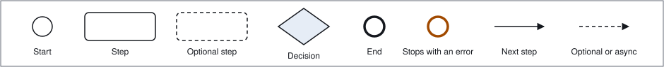

# 10. User Flows

Each flow shows one way people use qdbd, from what starts it to the outcome, as a swimlane diagram. Each lane is a person or system, and the boxes are steps in the order they happen. The step table under each diagram gives the commands and options. The links lead to the full docs.

Use them to pick the right workflow for a team, to explain qdbd to someone who doesn't use the command line, or to check a process before you automate it.

## Reading the diagrams

{ .flow }

**Who appears in the lanes:**

| Lane | Who it is |
|---|---|
| Data modeller | Writes and maintains the schema files |
| Developer | Changes the schema in a branch and opens pull requests |
| Reviewer | Approves schema changes in a pull request |
| Stakeholder / Analyst | Reads the diagram to understand the data or to write queries |
| qdbd | The command-line tool. In VS Code, the extension runs it for you |
| GitHub Actions | Runs qdbd on every pull request and push |
| AI assistant | Claude, Copilot or Cursor, asking qdbd about the schema |

## All flows

| # | Flow | Who | Starts when | Outcome |
|---|---|---|---|---|
| | **10.2 Build the model** | | | |
| 1 | [First diagram](build.md#first-diagram) | Data modeller, Stakeholder | Someone needs a picture of the data model | A diagram the stakeholder can explore |
| 2 | [Edit live and arrange tables](build.md#live-edit) | Data modeller | The schema needs changes or a tidier layout | Saved schema and table positions |
| 3 | [Organise a large schema](build.md#large-schema) | Data modeller | The diagram has too many tables to read | Tables grouped by domain, easy to filter |
| 4 | [Switch syntax](build.md#convert) | Data modeller | The team moves between QuickDBD and DBML | The same schema in the other syntax |
| | **10.3 Review changes** | | | |
| 5 | [Review a branch locally](review.md#branch-review) | Developer, Reviewer | A branch changes the schema | Changes highlighted on the diagram |
| 6 | [Pull request check](review.md#pr-check) | Developer, GitHub Actions, Reviewer | A pull request is opened or updated | Checked schema, change summary on the PR |
| 7 | [Publish after merge](review.md#publish) | GitHub Actions, Stakeholder | A change is merged into the main branch | Up-to-date diagram on a website |
| | **10.4 Use and share** | | | |
| 8 | [Find how two tables join](share.md#find-join) | Analyst | A query needs two tables joined | A ready-made SQL join |
| 9 | [Put a picture in docs or slides](share.md#export-picture) | Data modeller | A document needs an image of the model | A PNG, SVG or draw.io file |
| 10 | [Share a link](share.md#share-link) | Data modeller, Stakeholder | Someone without the files needs to see the diagram | A file, a private link or a live view |
| | **10.5 Other ways in** | | | |
| 11 | [Start from a dbt project](integrations.md#dbt) | Data modeller | The tables already live in dbt | Schema files generated or linked to dbt |
| 12 | [Work in VS Code](integrations.md#vscode) | Data modeller | The team prefers an editor to a terminal | The same steps, from editor buttons |
| 13 | [Ask an AI assistant](integrations.md#ai-assistant) | Developer, AI assistant | Someone asks a question about the schema | Answers taken from the real schema |
