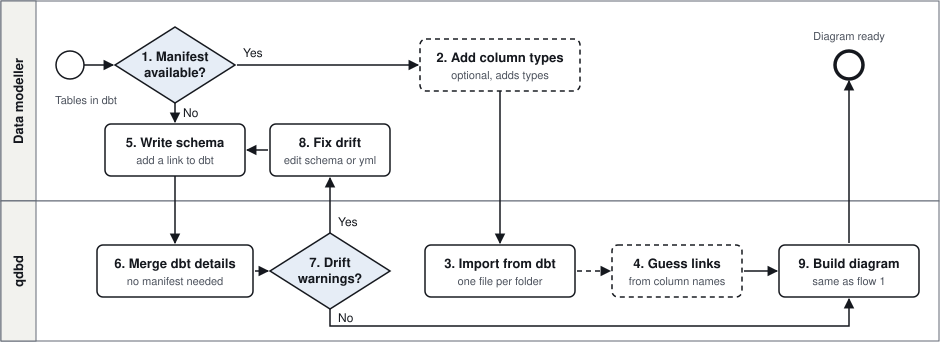
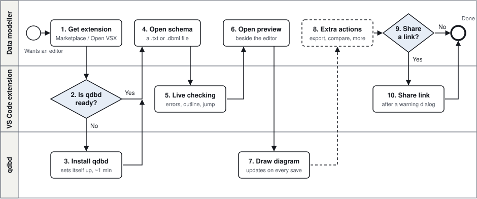
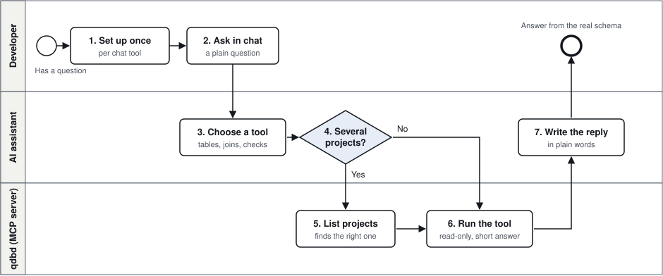

# 10.5 Other Ways In

Three ways to use qdbd without writing every table by hand or typing every command: from a dbt project, from VS Code, or by asking an AI assistant. Back to [all flows](index.md).

## 11. Start from a dbt Project { #dbt }

**Who:** Data modeller · **Starts when:** The tables already live in dbt · **Outcome:** Schema files generated from dbt, or a hand-written schema linked to it

[{ .flow }](../assets/img/flows/11-dbt.svg)

| # | Step | Who | What happens |
|---|---|---|---|
| 1 | Manifest available? | Data modeller | Look for `target/manifest.json`. `dbt compile` writes it. dbt Cloud users often don't have one locally. |
| 2 | Add column types (optional) | Data modeller | Run `dbt docs generate`. This writes `catalog.json` next to the manifest. Without it, undocumented models have no columns and qdbd prints a hint. |
| 3 | Import from dbt | qdbd | `qdbd import dbt target/ -o erd/` writes one file per dbt folder. Use `-o schema.txt` for a single file. It reads models, seeds, snapshots and sources. Primary keys come from a `primary_key` constraint, else the first column with `unique` and `not_null` tests. Relationships come from `relationships` tests and `foreign_key` constraints. |
| 4 | Guess links (optional) | qdbd | Add `--infer-fks` to guess joins from column names ending in `_id`, `_key` or `_sk`. Ties are skipped and reported, never guessed. Declared relationships win. |
| 5 | Write schema | Data modeller | Write the schema by hand. Add `# @dbt: ../my_dbt_project` (the folder with `dbt_project.yml`). Add `# @dbt: none` above a table to opt it out. |
| 6 | Merge dbt details | qdbd | Reads the dbt yml files directly, with no manifest. Descriptions, tags and `data_type` show on the diagram. |
| 7 | Drift warnings? | qdbd | `qdbd check` warns when a column is missing, a type disagrees, a column is not in the yml, or no model has that name. VS Code shows the same warnings. |
| 8 | Fix drift | Data modeller | Edit the schema or the yml, then check again. |
| 9 | Build diagram | qdbd | A normal build, as in [flow 1](build.md#first-diagram). |

- Re-running the import keeps your table arrangement. Stale generated files are removed. Your own files are kept.
- In CI, `qdbd import dbt target/ -o erd/ --check` writes nothing and exits 1 if the committed files are stale. `qdbd check --strict` fails the build on drift.
- dbt has no foreign keys of its own, so add `relationships` tests to get lines on the diagram.

More: [dbt Import](../dbt.md), [Guessing relationships](../dbt.md#guessing-relationships-infer-fks), [Descriptions from dbt yml](../dbt.md#descriptions-from-dbt-yml), [Drift warnings](../dbt.md#drift-warnings)

## 12. Work in VS Code { #vscode }

**Who:** Data modeller · **Starts when:** The team prefers an editor to a terminal · **Outcome:** The same steps as the command line, from editor buttons

[{ .flow }](../assets/img/flows/12-vscode.svg)

| # | Step | Who | What happens |
|---|---|---|---|
| 1 | Get extension | Data modeller | Install **QuickDBD (qdbd)** from the VS Code Marketplace. Cursor, Windsurf and VSCodium use Open VSX. In a restricted (untrusted) workspace the extension stays off until you trust it. |
| 2 | Is qdbd ready? | VS Code extension | It looks for `qdbd` 0.2.0 or later: the `quickdbd.qdbdPath` setting, then the workspace `.venv` or `venv`, then the newer of its own install and `PATH`. |
| 3 | Install qdbd | qdbd | Click **Install qdbd** (or **Update qdbd**). The extension builds its own Python environment, which takes about a minute. It needs Python 3.11+ or `uv` on the machine. |
| 4 | Open schema | Data modeller | Open a `.txt` file detected as QuickDBD or DBML, or a `.dbml` file. |
| 5 | Live checking | VS Code extension | Errors are underlined as you type, before you save. The Outline and go-to-definition (F12) work. |
| 6 | Open preview | Data modeller | **Cmd+K V** (**Ctrl+K V**) opens the diagram beside the editor. |
| 7 | Draw diagram | qdbd | The preview updates on save and follows the cursor. Double-click a table to jump to its line. Dragging tables saves them to the layout file. |
| 8 | Extra actions (optional) | Data modeller | From the editor title, the sidebar (Schemas and Actions) or the command palette: **Open in Browser**, **Compare with Git Ref…**, export PNG, SVG or draw.io, **Export HTML Page**, **Import dbt Project…**, convert to DBML or QuickDBD syntax. |
| 9 | Share a link? | Data modeller | **Share as a Gist Link** is hidden until the user setting `quickdbd.allowSharing` is on. A workspace can't turn it on. |
| 10 | Share link | VS Code extension | A dialog warns first. Nothing uploads until you press **Share**. It signs in with your VS Code GitHub account, so the `gh` tool is not needed. It makes a secret gist and copies the link. Sharing again updates the same gist. |

- You never need a terminal. The extension installs and runs `qdbd` for you.
- Share only if your data policy allows the schema on GitHub.

More: [Editing in VS Code](../vscode.md), [Install](../vscode.md#install), [The sidebar](../vscode.md#sidebar), [Troubleshooting](../vscode.md#troubleshooting)

## 13. Ask an AI Assistant { #ai-assistant }

**Who:** Developer, AI assistant · **Starts when:** Someone asks a question about the schema · **Outcome:** An answer taken from the real schema, not a guess

[{ .flow }](../assets/img/flows/13-ai-assistant.svg)

| # | Step | Who | What happens |
|---|---|---|---|
| 1 | Set up once | Developer | Needs qdbd 0.3.0 or later. Claude Code: `claude mcp add qdbd -- qdbd mcp`, or commit a `.mcp.json` for the team. VS Code with the extension (1.101+): nothing to do. Cursor: add `.cursor/mcp.json` with `--root ${workspaceFolder}`. Claude Desktop: pass `--root /path/to/project`. |
| 2 | Ask in chat | Developer | Ask a plain question, such as "How do orders join to customers?" |
| 3 | Choose a tool | AI assistant | Picks one of: `list_tables`, `describe_tables`, `search_schema`, `join_path` (with SQL), `check_schema`, `diff_schema`, `render_diagram` (PNG) or `syntax_reference`. |
| 4 | Several projects? | AI assistant | qdbd finds schema projects and dbt projects (`dbt_project.yml` plus `target/manifest.json`, read in memory) under the project folder. If it finds more than one, the assistant must say which. |
| 5 | List projects | qdbd | `list_projects` shows what was found, so the assistant can pass a `project` to the other tools. |
| 6 | Run the tool | qdbd | Reads the schema and returns short plain text. A long answer says what it left out. `diff_schema` compares a branch from where it left `main`. |
| 7 | Write the reply | AI assistant | Answers the developer using what qdbd returned. |

- Every tool only reads. Nothing is written.
- Whatever a tool returns is sent to your AI provider as part of the chat.
- qdbd won't search your whole disk or home folder. Pass `--root` there.
- `invalid choice: 'mcp'` means qdbd is too old. `no schema files found` means the wrong folder: pass `--root`.

More: [AI Agents (MCP)](../mcp.md), [Set it up](../mcp.md#set-it-up), [The tools](../mcp.md#the-tools), [Privacy](../mcp.md#privacy), [Troubleshooting](../mcp.md#troubleshooting)
