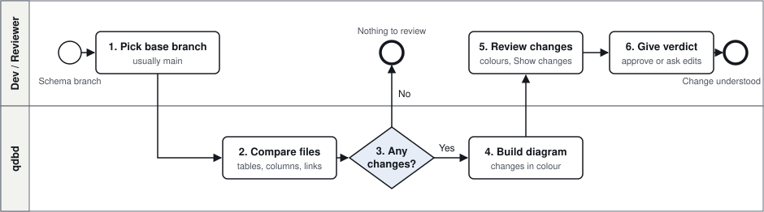
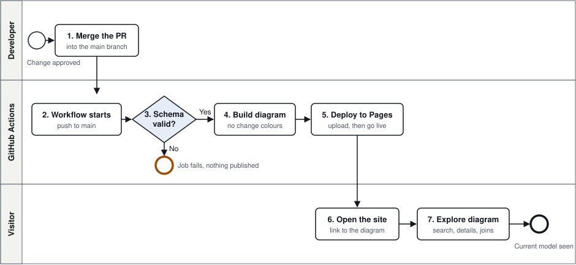

# 10.3 Review Changes

These flows show how a schema change is checked, reviewed and published. Back to [all flows](index.md).

## 5. Review a Branch Locally { #branch-review }

**Who:** Developer or Reviewer · **Starts when:** A branch changes the schema · **Outcome:** The reviewer understands the change and approves it or asks for edits

[{ .flow }](../assets/img/flows/05-branch-review.svg)

| # | Step | Who | What happens |
|---|---|---|---|
| 1 | Pick base branch | Developer or Reviewer | Choose the branch to compare with, usually `main`. |
| 2 | Compare files | qdbd | `qdbd diff --base main erd/` lists tables, columns and relationships that were added, removed or changed. It reads the base files with `git show`, so nothing is checked out. |
| 3 | Any changes? | qdbd | No: there is nothing to review. Yes: continue. `--exit-code` makes the command exit 1 when something changed, which is handy in scripts. |
| 4 | Build diagram | qdbd | `qdbd build erd/ --diff-base main -o review.html`. For a live view that recolours on every save, use `qdbd serve erd/ --diff-base main`. |
| 5 | Review changes | Developer or Reviewer | Open the page. New tables are green, changed ones amber, removed ones red. Removed columns stay, red and struck through. A banner shows the counts, and **Show changes** keeps only changed tables and their neighbours. The details panel lists each change. |
| 6 | Give verdict | Reviewer | Approve, or ask for edits. |

- `--format text|markdown|json` and `-o FILE` change how `qdbd diff` prints its report.
- A ref that starts with `-` is refused. A git error (for example an unknown ref) exits with code 2.
- In VS Code, **Compare with Git Ref…** does steps 2 to 5 for you. Pick HEAD to see uncommitted work.

More: [Compare two versions](../diffs.md#compare-two-versions), [See the changes in the diagram](../diffs.md#see-the-changes-in-the-diagram), [diff](../cli.md#diff), [build](../cli.md#build), [serve](../cli.md#serve), [VS Code](../vscode.md#what-you-get)

## 6. Pull Request Check { #pr-check }

**Who:** Developer, GitHub Actions, Reviewer · **Starts when:** A pull request is opened or updated · **Outcome:** The schema is checked, and the pull request shows what changed

[{ .flow }](../assets/img/flows/06-pr-check.svg)

| # | Step | Who | What happens |
|---|---|---|---|
| 1 | Update the PR | Developer | Open the pull request or push more commits. This starts the qdbd GitHub Action. |
| 2 | Install qdbd | GitHub Actions | Sets up Python and installs qdbd. |
| 3 | Import from dbt | GitHub Actions | Only when the `dbt-manifest` input is set: `qdbd import dbt` writes the schema files first. With `dbt-check: true` it does not rewrite them, and fails if the committed files are out of date. |
| 4 | Schema valid? | GitHub Actions | `qdbd check --format github` (when `check` is true, the default). Errors appear as notes on the pull request lines and the job fails. The developer fixes them and pushes again, which restarts the flow. |
| 5 | Compare to base | GitHub Actions | `qdbd diff --base origin/<base> --format markdown --exit-code`. It compares with the latest commit of the base branch, not the point where the branch forked. Exit 0 means no change, exit 1 means changed. |
| 6 | Build diagram | GitHub Actions | `qdbd build --diff-base origin/<base>`, so changes are coloured. |
| 7 | Upload artifact | GitHub Actions | The HTML is saved with the run as the **erd** artifact (`upload-artifact`, on by default). |
| 8 | Fork PR? | GitHub Actions | A pull request from a fork has no write token. The summary goes to the run summary page only. |
| 9 | Comment needed? | GitHub Actions | The action looks for its own comment, which starts with `<!-- qdbd-erd-diff -->`. If it exists, it is updated on every run, even with no changes, so a reverted change clears it. If it does not exist, a new one is posted only when the schema changed. |
| 10 | Post or update | GitHub Actions | Posts or updates the one comment. It is text only, with no images. |
| 11 | Read summary | Reviewer | The comment has a line of counts, sections for tables added, removed and changed, and relationships. The footer links to the run. |
| 12 | Open diagram | Reviewer | Download the **erd** artifact and open the HTML. Colours and **Show changes** work as in [flow 5](#branch-review). |
| 13 | Change approved? | Reviewer | Approve, then merge (see [flow 7](#publish)), or request changes. The developer then fixes and pushes again. |

- The comment needs `pull-requests: write`. No secrets are needed.
- Action outputs: `changed` is `true` when the schema changed, and `diff-file` is the markdown diff.
- The same `diff` and `build` commands work in any CI.

More: [CI and Automation](../github-action.md#github-action), [Inputs](../github-action.md#inputs), [Reviewing Schema Changes](../diffs.md), [GitLab CI](../github-action.md#gitlab)

## 7. Publish After Merge { #publish }

**Who:** Developer, GitHub Actions, Visitor · **Starts when:** A change is merged into the main branch · **Outcome:** An always-current diagram on a website

[{ .flow }](../assets/img/flows/07-publish.svg)

| # | Step | Who | What happens |
|---|---|---|---|
| 1 | Merge the PR | Developer | Merging pushes to the main branch. |
| 2 | Workflow starts | GitHub Actions | The workflow runs on the push. |
| 3 | Schema valid? | GitHub Actions | The qdbd GitHub Action runs `qdbd check`. On errors the job fails and nothing is published. |
| 4 | Build diagram | GitHub Actions | `qdbd build` runs with no base, so there are no change colours. The action also uploads the **erd** artifact. |
| 5 | Deploy to Pages | GitHub Actions | The action has no Pages step. Your workflow uploads the built folder with `actions/upload-pages-artifact` and deploys it with `actions/deploy-pages`. The deploy job needs `pages: write` and `id-token: write`. |
| 6 | Open the site | Visitor | Opens the Pages link in a browser. No install needed. |
| 7 | Explore diagram | Visitor | Searches tables, reads details and finds joins. |

- A Pages site is public unless you restrict it. Publish a client's schema only where the agreement allows it.
- On GitLab, plain `qdbd` commands in `.gitlab-ci.yml` give the same result, published with GitLab Pages.

More: [Publishing to GitHub Pages](../github-action.md#publishing-to-github-pages), [GitLab CI](../github-action.md#gitlab), [Step 4: Automate in CI](../example/ci.md#publish-the-diagram)
