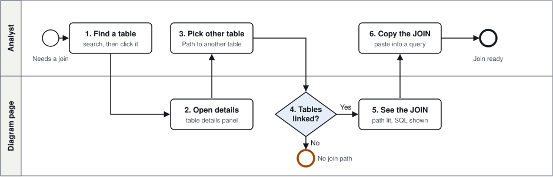
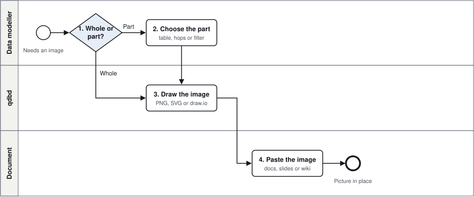
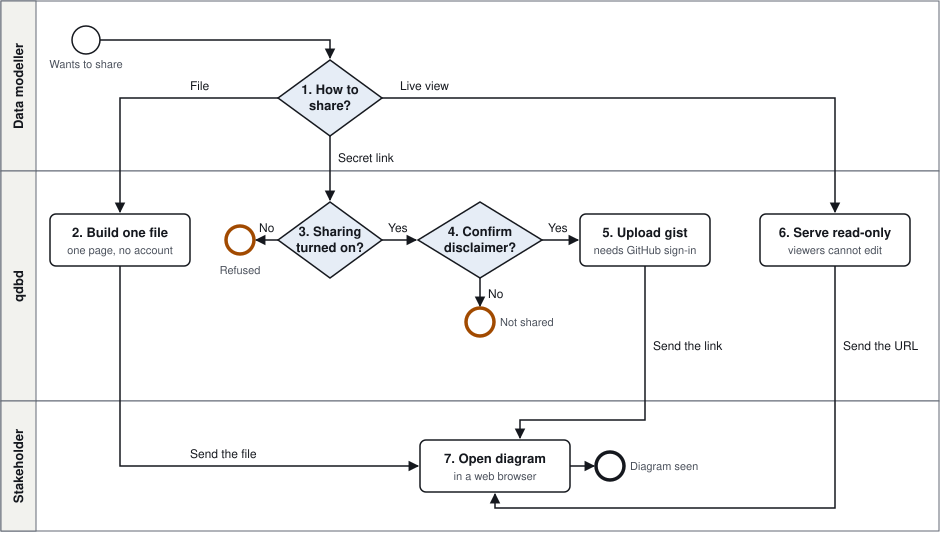

# 10.4 Use and Share

Three flows for using the finished diagram: finding a join, making a picture and sending it to someone. Back to [all flows](index.md).

## 8. Find How Two Tables Join { #find-join }

**Who:** Analyst · **Starts when:** a query needs two tables joined · **Outcome:** a ready-made SQL join

[{ .flow }](../assets/img/flows/08-find-join.svg)

| # | Step | Who | What happens |
|---|---|---|---|
| 1 | Find a table | Analyst | Press `/` to search names, aliases and groups. Enter jumps to the best match. Click the table. |
| 2 | Open details | Diagram page | The details panel opens with columns, **References** and **Referenced by**. |
| 3 | Pick other table | Analyst | Use **Path to another table** and choose the second table. |
| 4 | Tables linked? | Diagram page | If a relationship path exists, the page highlights the shortest one. If not, there is no join to show. |
| 5 | See the JOIN | Diagram page | The path is lit on the canvas and a SQL `JOIN` is shown. **Show only this path** keeps just those tables on screen. |
| 6 | Copy the JOIN | Analyst | Copy the SQL into the query. |

- **Click a line instead:** a card shows a plain-English sentence, the `JOIN`, **Copy JOIN** and **Show both tables**. Esc clears it.
- **No browser:** `qdbd path erd/ --from orders --to customers` prints the shortest path and a `FROM … JOIN … ON …` snippet. It exits 1 when the tables are not connected.
- **Share the view:** the toolbar **Link** button copies a URL that keeps the selected table and path.

More: [Details panel](../reading-the-diagram.md#details-panel), [Relationship lines](../reading-the-diagram.md#relationship-lines), [path command](../cli.md#path), [Selectors](../selectors.md).

## 9. Put a Picture in Docs or Slides { #export-picture }

**Who:** Data modeller · **Starts when:** a document needs an image of the model · **Outcome:** a PNG, SVG or draw.io file in the document

[{ .flow }](../assets/img/flows/09-export-picture.svg)

| # | Step | Who | What happens |
|---|---|---|---|
| 1 | Whole or part? | Data modeller | A whole 200-table diagram is rarely readable on a slide. Decide what the reader needs. |
| 2 | Choose the part | Data modeller | `--focus orders --depth 2` takes a table and everything within 2 relationship hops (default depth is 1). Or use `-s` / `--exclude` selectors. A selection gets a compact fresh layout. |
| 3 | Draw the image | qdbd | `qdbd export erd/ -o orders.png` writes the file. The extension picks the format: `.png`, `.svg` or `.drawio` (editable in draw.io). |
| 4 | Paste the image | Document | Add the file to the doc, slides or wiki. |

- **Looks:** `--mode full\|keys\|header` collapses tables, `--scale` sets PNG size (default 2), `--regions` or `--by-group` shades areas.
- **Same everywhere:** output is identical on every machine and needs no browser. Export does not write your layout file.
- **From the page:** the toolbar **SVG**, **PNG** and **draw.io** buttons export what is on screen. Exports always use light colours.

More: [Exports](../exports.md), [export command](../cli.md#export), [Table positions](../layout.md).

## 10. Share a Link { #share-link }

**Who:** Data modeller, Stakeholder · **Starts when:** someone without the files needs to see the diagram · **Outcome:** a file, a private link or a live view

[{ .flow }](../assets/img/flows/10-share-link.svg)

| # | Step | Who | What happens |
|---|---|---|---|
| 1 | How to share? | Data modeller | Pick one of three ways: file, secret link or live view. |
| 2 | Build one file | qdbd | `qdbd build erd/` writes one self-contained HTML file. Send it through your own channels. No account is needed and the schema goes nowhere new. |
| 3 | Sharing turned on? | qdbd | `qdbd share erd/` refuses (exit 2) unless the environment variable `QDBD_ALLOW_SHARE=1` is set. |
| 4 | Confirm disclaimer? | Data modeller | qdbd shows the disclaimer every time and asks `Share N tables as a secret gist? [y/N]`. Anything but `y` prints "Not shared." Scripts pass `--yes`. With no terminal and no `--yes`, it errors. |
| 5 | Upload gist | qdbd | With the `gh` CLI signed in (`gh auth login`), qdbd uploads a secret gist and prints a link. Send that link. |
| 6 | Serve read-only | qdbd | `qdbd serve erd/ --read-only` behind a tunnel gives a live link. Send the tunnel address. |
| 7 | Open diagram | Stakeholder | Opens the file or link in a web browser and explores the full page. |

- **Disclaimer:** by turning sharing on you confirm you have the right to publish the schema. Table and column names can be confidential, so a client's agreements may not allow it.
- **Gist links:** running `qdbd share` again for the same files updates the same gist. Viewers may need a few minutes to see it. `--new` makes a separate gist and `--public` lists it. To stop sharing, delete the gist.
- **Live view:** there is no editor pane, every write is refused, nothing is written to disk, and the page still reloads when you save.
- **Warning:** without `--read-only`, anyone with the tunnel URL can edit your files. Always add it, and stop the tunnel when you are done.

More: [Sharing a link](../sharing.md), [qdbd share](../sharing.md#qdbd-share), [Live read-only link](../sharing.md#live-read-only-link), [Disclaimer](../sharing.md#disclaimer), [Exit codes](../cli.md#exit-codes).
