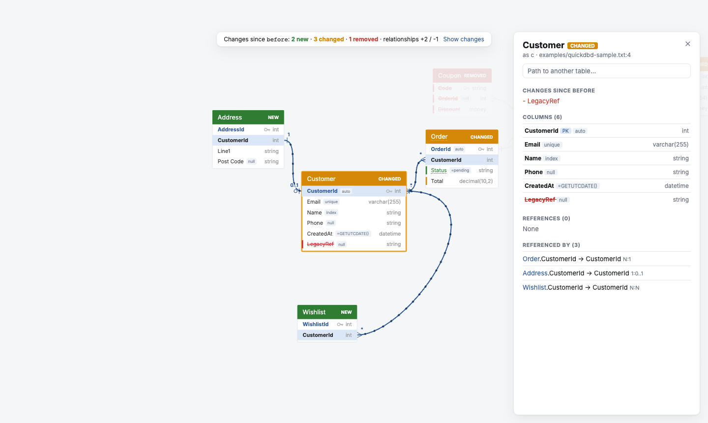

# 7. CI and Automation

qdbd is a plain CLI, so it runs in any CI. On **GitHub**, the action below does the whole job ([7.1](#github-action)); on **GitLab**, one `.gitlab-ci.yml` does the same ([7.6](#gitlab)); elsewhere, see [7.7](#not-on-github).

## 7.1 GitHub Action { #github-action }

Add this file to your repo:

```yaml title=".github/workflows/erd.yml"
name: ERD
on: [pull_request, push]
jobs:
  erd:
    runs-on: ubuntu-latest
    permissions: { contents: read, pull-requests: write }   # write: for the PR comment
    steps:
      - uses: actions/checkout@v4
      - uses: MarkPhamm/quickdbd-cli@v0.6.12
        with:
          path: erd/                  # schema file(s) or folder(s)
          output: site/index.html
```

**What it does.** On every run, it:

1. installs qdbd from PyPI (and, with `dbt-manifest`, runs `qdbd import dbt`);
2. runs `qdbd check` and fails the job on errors (or warnings, with `strict: true`), annotating each problem on its line in the pull request;
3. builds the HTML diagram and uploads it as the **erd** artifact.

On pull requests it also:

4. fetches the base branch and runs `qdbd diff --base origin/<base>`;
5. builds the diagram with `--diff-base`, so changes are highlighted;
6. posts **one** comment with the markdown diff, and updates that same comment on later pushes. A pull request that changes no schema gets no comment. On pull requests from forks, whose token is read-only, the diff goes to the run summary instead.

{ .shot }

## 7.2 Inputs { #inputs }

| Input | Default | |
|---|---|---|
| `path` | `erd/` | schema files or folders, space-separated; with `dbt-manifest`, where the import writes |
| `dbt-manifest` | | dbt `manifest.json` or `target/`: generate the schema with `qdbd import dbt` first |
| `dbt-args` | | extra import options, e.g. `--infer-fks --no-sources` |
| `dbt-check` | `false` | with `dbt-manifest`: don't regenerate; fail if the committed files are out of date |
| `output` | `erd/index.html` | where to write the HTML |
| `site` | | a folder for one diagram per `path` entry plus an index ([several diagrams](#several-diagrams)); replaces `output` |
| `check` | `true` | fail on schema errors |
| `strict` | `false` | also fail on QuickDBD-compatibility warnings |
| `comment` | `true` | post the diff comment on pull requests |
| `select` | | [selector](selectors.md) for the diagram |
| `upload-artifact` | `true` | upload the HTML (or the `site` folder) as `erd` |
| `qdbd-version` | `latest` | PyPI version to install |
| `python-version` | `3.12` | |
| `github-token` | `${{ github.token }}` | token for the comment |

## 7.3 Outputs { #outputs }

| Output | |
|---|---|
| `html` | path of the built page (with `site`, its `index.html`) |
| `changed` | `"true"` when the pull request changes the schema |
| `diff-file` | markdown diff (pull requests) |

## 7.4 Publishing to GitHub Pages { #publishing-to-github-pages }

!!! warning "A Pages site is public unless you restrict it"
    Anyone can open a GitHub Pages site, unless it's published from a private or internal repository of an organisation on GitHub Enterprise Cloud with [access control](https://docs.github.com/en/enterprise-cloud@latest/pages/getting-started-with-github-pages/changing-the-visibility-of-your-github-pages-site) turned on. Publish a client's schema only where their agreement allows it. Publishing means you accept the [disclaimer](sharing.md#disclaimer).

Upload `output`'s folder with `actions/upload-pages-artifact` and deploy it with `actions/deploy-pages` on pushes to your main branch. [5.6 Step 4: Automate in CI](example/ci.md#publish-the-diagram) has the full workflow.

### Several diagrams { #several-diagrams }

When each folder is its own diagram (say `docs/erd/sales/` and `docs/erd/hr/`), set `site` instead of `output`. The action then builds `site/sales.html`, `site/hr.html` and an `index.html` linking them, with [`qdbd build --site`](cli.md#build). Each folder is checked and diffed on its own, so two diagrams can share table names, and the pull request comment has a section per folder:

```yaml
- uses: MarkPhamm/quickdbd-cli@v0.6.12
  with:
    path: docs/erd/*/
    site: site/
```

The glob is expanded by the shell, and folders with no schema files are skipped. Deploy `site/` to Pages as above.

## 7.5 With dbt { #with-dbt }

Run your dbt build first, then point the action at the manifest:

```yaml
- uses: MarkPhamm/quickdbd-cli@v0.6.12
  with:
    dbt-manifest: target/
    dbt-args: --infer-fks
    path: erd/
```

Commit `erd/` so pull requests have a base to diff against. Walkthrough: [5.6 Step 4: Automate in CI](example/ci.md).

For a hand-drawn ERD linked to the yml with `# @dbt:` (no manifest), [qdbd-dbt-demo](https://github.com/MarkPhamm/qdbd-dbt-demo) is a working setup: `qdbd check --strict` fails a pull request on drift, and each branch publishes its own diagram to Pages.

## 7.6 GitLab CI { #gitlab }

GitLab gets the same results from plain `qdbd` commands, in one `.gitlab-ci.yml`:

| | GitHub (7.1) | GitLab (this section) |
|---|---|---|
| Check the schema, fail on errors | yes | yes |
| Diagram as a download | **erd** artifact | **ERD** link in the merge request |
| Schema diff as a comment, updated on each push | yes | yes, with a project access token |
| Diagram with the changes coloured | yes | yes |
| Publish from the default branch | GitHub Pages (7.4) | GitLab Pages |

```yaml title=".gitlab-ci.yml"
.qdbd:
  image: python:3.12            # includes git, for --base and --diff-base
  before_script: [pip install quickdbd-cli==0.6.12]

# every pipeline that changes erd/: check, then build the diagram
erd:
  extends: .qdbd
  rules:
    - changes: [erd/**/*]
  script:
    - qdbd check --strict erd/
    - qdbd build erd/ -o public/index.html
  artifacts:
    paths: [public/]
    expose_as: ERD

# merge requests: the diff as a comment, and the diagram with the changes coloured
erd-diff:
  extends: .qdbd
  rules:
    - if: $CI_PIPELINE_SOURCE == "merge_request_event"
      changes: [erd/**/*]
  variables:
    GIT_DEPTH: 0
    BASE: origin/$CI_MERGE_REQUEST_TARGET_BRANCH_NAME
  script:
    - git fetch origin "$CI_MERGE_REQUEST_TARGET_BRANCH_NAME"
    - qdbd build erd/ --diff-base "$BASE" -o changes/index.html
    - qdbd diff --base "$BASE" erd/ --format markdown -o changes/diff.md --exit-code || code=$?
    - if [ "${code:-0}" -gt 1 ]; then exit "$code"; fi
    - |
      if [ "${code:-0}" -eq 1 ] && [ -n "$QDBD_GITLAB_TOKEN" ]; then python - <<'EOF'
      import json, os, urllib.request
      api = "{}/projects/{}/merge_requests/{}/notes".format(
          os.environ["CI_API_V4_URL"], os.environ["CI_PROJECT_ID"], os.environ["CI_MERGE_REQUEST_IID"])
      head = {"PRIVATE-TOKEN": os.environ["QDBD_GITLAB_TOKEN"], "Content-Type": "application/json"}
      marker = "<!-- qdbd-erd-diff -->"
      body = marker + "\n" + open("changes/diff.md", encoding="utf-8").read()
      notes = json.load(urllib.request.urlopen(urllib.request.Request(api + "?per_page=100", headers=head)))
      old = next((n for n in notes if n["body"].startswith(marker)), None)
      url, method = (f"{api}/{old['id']}", "PUT") if old else (api, "POST")
      urllib.request.urlopen(urllib.request.Request(url, json.dumps({"body": body}).encode(), head, method=method))
      EOF
      fi
  artifacts:
    paths: [changes/]
    expose_as: ERD changes

# the default branch: publish the diagram to GitLab Pages
pages:
  extends: .qdbd
  rules:
    - if: $CI_COMMIT_BRANCH == $CI_DEFAULT_BRANCH
      changes: [erd/**/*]
  script:
    - qdbd build erd/ -o public/index.html
  artifacts:
    paths: [public/]
```

**What it does.**

1. `erd` runs `qdbd check --strict` and fails the pipeline on errors or warnings (drop `--strict` to allow warnings), then builds the diagram. The merge request shows an **ERD** link to it.
2. On a merge request, `erd-diff` compares `erd/` with the target branch. **ERD changes** links to the diagram with new tables in green, changed in amber and removed in red ([6.2](diffs.md#see-the-changes-in-the-diagram)), and to `diff.md`.
3. When the schema changed, it posts the diff as **one** comment on the merge request and updates that same comment on later pushes, like the GitHub action.
4. On the default branch, `pages` publishes the diagram. GitLab publishes the `public/` folder of a job named `pages`.

**The comment needs a token.** GitLab's built-in job token can't write comments. Create a project access token (**Settings > Access tokens**, role *Reporter*, scope `api`) and save it as a masked CI/CD variable named `QDBD_GITLAB_TOKEN`. Without it, everything else still runs and `diff.md` stays in the artifacts. Merge requests from forks don't get the variable, so they get no comment.

!!! warning "A Pages site may be public"
    Who can open a GitLab Pages site depends on the project's visibility and its Pages access control setting. Publish a client's schema only where their agreement allows it. Publishing means you accept the [disclaimer](sharing.md#disclaimer).

**Several diagrams.** For one diagram per folder, as in [several diagrams](#several-diagrams), use `--each` and `--site`:

```yaml
    - qdbd check --strict --each docs/erd/*/
    - qdbd build docs/erd/*/ --site public/
```

**With dbt.** Run your dbt build first, then regenerate `erd/` from the manifest before the other commands, as the action's `dbt-manifest` input does ([7.5](#with-dbt)):

```yaml
    - qdbd import dbt target/ -o erd/ --infer-fks
```

## 7.7 Other CI { #not-on-github }

The action and the GitLab jobs only wrap the CLI, so any CI that runs Python 3.11+ can do the same: `pip install quickdbd-cli`, then `qdbd check --strict`, `qdbd build`, and on a branch `qdbd diff --base <ref> --format markdown` and `qdbd build --diff-base <ref>` ([8. CLI Reference](cli.md)). `git` must be installed for `--base` and `--diff-base`.

## 7.8 pre-commit { #pre-commit }

To check schema files before every commit, add the [pre-commit](https://pre-commit.com) hook:

```yaml
repos:
  - repo: https://github.com/MarkPhamm/quickdbd-cli
    rev: v0.6.12
    hooks:
      - id: qdbd-check
        files: ^erd/.*\.(txt|dbml)$
```
