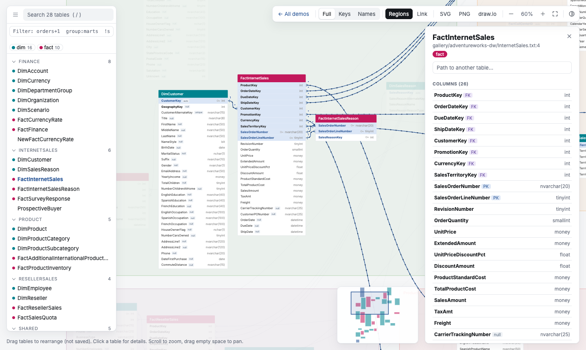

# Guide

qdbd turns **database schemas into interactive ER diagrams** that stay readable at hundreds of tables. Write the schema in [QuickDBD](https://www.quickdatabasediagrams.com)'s plain-text syntax or [DBML](dbml.md), or generate it from a **dbt project**. qdbd checks it, lays it out, and builds a single HTML page you can explore, share and review in pull requests.

The schema is a text file, so it lives in git next to your code. Diagrams are generated from it and never edited by hand. Table positions are the only thing you arrange yourself, and they're saved in a small layout file so the diagram stays put.

[Live demos](../demo/){ .md-button .md-button--primary } [200-table demo](../demo/synthetic/){ .md-button } [Quick start](getting-started.md){ .md-button }

[{ .shot }](../demo/adventureworks/#t=SalesOrderHeader)

## The workflow

<div class="workflow" markdown>

```text
dbt project ──qdbd import dbt──┐
                               ├──▶ schema/*.txt, *.dbml  ──▶  canonical source (QuickDBD syntax or DBML, in git)
hand-written / pasted ─────────┘           │
                                           ├──▶ qdbd check   : QuickDBD-compatible validation    ──▶ CI gate
                                           ├──▶ qdbd serve   : live editor, drag to arrange      ──▶ schema.layout.json
                                           ├──▶ qdbd build   : interactive HTML                  ──▶ GitHub Pages / artifact
                                           ├──▶ qdbd diff    : what changed vs main              ──▶ PR comment
                                           ├──▶ qdbd export  : PNG · SVG · draw.io               ──▶ docs, slides, wikis
                                           └──▶ qdbd mcp     : schema tools for AI agents        ──▶ Claude, Copilot, Cursor
```

</div>

Every command reads the same schema files, so the page, the images and the PR comment always agree. The [GitHub Action](github-action.md#github-action) runs `check`, `build` and `diff` on every pull request.

## The guide

Read it in order the first time; each step builds on the one before.

| # | Section | You'll learn |
|---|---|---|
| 1 | [Install](install.md) | Install with pip, pipx or uv, or run without installing |
| 2 | [Quick Start](getting-started.md) | Write, check, edit, build and export your first diagram in 5 minutes |
| 3 | [Schema Files](syntax.md) | The [syntax](syntax.md), [splitting a schema into files](files.md), [table positions](layout.md), [tags and colours](tags.md), [VS Code](vscode.md) and [AI agents](mcp.md) |
| 4 | [Exploring a Diagram](reading-the-diagram.md) | [Reading the page](reading-the-diagram.md), [filtering with selectors](selectors.md), [exports](exports.md), and [sharing a link](sharing.md) |
| 5 | [dbt Projects](dbt.md) | Generate the schema from `manifest.json`, then follow [jaffle_shop](example/index.md) from import to CI |
| 6 | [Reviewing Changes](diffs.md) | What a branch changes, as a report and highlighted in the diagram |
| 7 | [CI and Automation](github-action.md) | The GitHub Action, GitHub Pages, pre-commit and other CI systems |
| 8 | [CLI Reference](cli.md) | Every command and exit code |
| 9 | [Development](development.md) | Working on qdbd itself |

<div class="grid cards" markdown>

- **New to qdbd?**

    Install it and build your first diagram.

    [:octicons-arrow-right-24: 1. Install](install.md)

- **Have a dbt project?**

    Generate the schema from `manifest.json`, with relationships from your tests.

    [:octicons-arrow-right-24: 5. dbt Projects](dbt.md)

- **Reading a diagram someone shared?**

    What the markers, colours, panels and filters mean.

    [:octicons-arrow-right-24: 4.1 Reading the Diagram](reading-the-diagram.md)

</div>

## The pieces

| Piece | What it does |
|---|---|
| [Schema syntax](syntax.md) | QuickDBD's text format, accepted unchanged. Error messages match QuickDBD's |
| [`qdbd check`](cli.md#check) | Validates every file; `file:line: error: …`, exit 1 on errors |
| [`qdbd serve`](cli.md#serve) | Local editor: reloads on save, browser editor pane, drag tables to arrange |
| [`qdbd layout`](cli.md#layout) | Writes table positions to the layout file: places new tables, or lays out everything again |
| [`qdbd build`](cli.md#build) | One self-contained HTML page: search, filters, path finder, regions, shareable links |
| [`qdbd share`](cli.md#share) | Publishes the page as a secret GitHub gist and prints the link |
| [`qdbd export`](exports.md) | PNG, SVG and editable draw.io files, for a whole schema or a selection |
| [`qdbd diff`](diffs.md) | Tables, columns and relationships changed against a git ref |
| [`qdbd path`](cli.md#path) | Shortest join path between two tables, as a SQL `JOIN` |
| [`qdbd import dbt`](dbt.md) | Schema files from a dbt `manifest.json` (+ `catalog.json`) |
| [`qdbd convert`](cli.md#convert) | QuickDBD text to DBML and back |
| [`qdbd mcp`](mcp.md) | The schema as tools for AI agents: tables, joins as SQL, checks, diffs |
| [GitHub Action](github-action.md) | Check, build and comment on pull requests |

```bash
pipx install quickdbd-cli
```

Pip-only: no Graphviz, Node or browser to install. Layout uses the [Eclipse Layout Kernel](https://eclipse.dev/elk/) in an embedded JavaScript engine.
