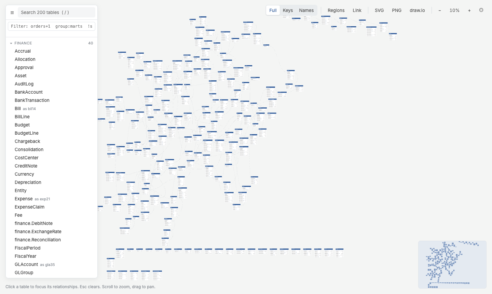

# qdbd - ERDs for QuickDBD & dbt

qdbd turns **database schemas into interactive ER diagrams** that stay readable at hundreds of tables. Write the schema in [QuickDBD](https://www.quickdatabasediagrams.com)'s plain-text syntax, or generate it from a **dbt project**. qdbd checks it, lays it out, and builds a single HTML page you can explore, share and review in pull requests.

The schema is a text file, so it lives in git next to your code. Diagrams are generated from it and never edited by hand. Table positions are the only thing you arrange yourself, and they're saved in a small layout file so the diagram stays put.

[Open the live demo (200 tables)](demo/){ .md-button .md-button--primary } [Get started](getting-started.md){ .md-button }

{ .shot }

## The workflow

<div class="workflow" markdown>

```text
dbt project ──qdbd import dbt──┐
                               ├──▶ schema/*.txt  ──▶  canonical source (QuickDBD syntax, in git)
hand-written / pasted ─────────┘           │
                                           ├──▶ qdbd check   : QuickDBD-compatible validation    ──▶ CI gate
                                           ├──▶ qdbd serve   : live editor, drag to arrange      ──▶ schema.layout.json
                                           ├──▶ qdbd build   : interactive HTML                  ──▶ GitHub Pages / artifact
                                           ├──▶ qdbd diff    : what changed vs main              ──▶ PR comment
                                           └──▶ qdbd export  : PNG · SVG · draw.io               ──▶ docs, slides, wikis
```

</div>

Every command reads the same `.txt` files, so the page, the images and the PR comment always agree. The [GitHub Action](github-action.md) runs `check`, `build` and `diff` on every pull request.

## Where to start

<div class="grid cards" markdown>

- **Writing a schema for the first time?**

    Install qdbd, write a few tables and open the live editor.

    [:octicons-arrow-right-24: Getting Started](getting-started.md)

- **Have a dbt project?**

    Generate the schema from `manifest.json` and follow a real project from import to CI.

    [:octicons-arrow-right-24: Worked example: jaffle_shop](example/index.md)

- **Reading a diagram someone shared?**

    What the markers, colours, panels and filters mean.

    [:octicons-arrow-right-24: Reading the Diagram](reading-the-diagram.md)

</div>

## The pieces

| Piece | What it does |
|---|---|
| [Schema syntax](syntax.md) | QuickDBD's text format, accepted unchanged. Error messages match QuickDBD's |
| [`qdbd check`](cli.md#check) | Validates every file; `file:line: error: …`, exit 1 on errors |
| [`qdbd serve`](cli.md#serve) | Local editor: reloads on save, browser editor pane, drag tables to arrange |
| [`qdbd build`](cli.md#build) | One self-contained HTML page: search, filters, path finder, regions, shareable links |
| [`qdbd export`](exports.md) | PNG, SVG and editable draw.io files, for a whole schema or a selection |
| [`qdbd diff`](diffs.md) | Tables, columns and relationships changed against a git ref |
| [`qdbd path`](cli.md#path) | Shortest join path between two tables, as a SQL `JOIN` |
| [`qdbd import dbt`](dbt.md) | Schema files from a dbt `manifest.json` (+ `catalog.json`) |
| [GitHub Action](github-action.md) | Check, build and comment on pull requests |

```bash
pipx install quickdbd-cli
```

Pip-only: no Graphviz, Node or browser to install. Layout uses the [Eclipse Layout Kernel](https://eclipse.dev/elk/) in an embedded JavaScript engine.
