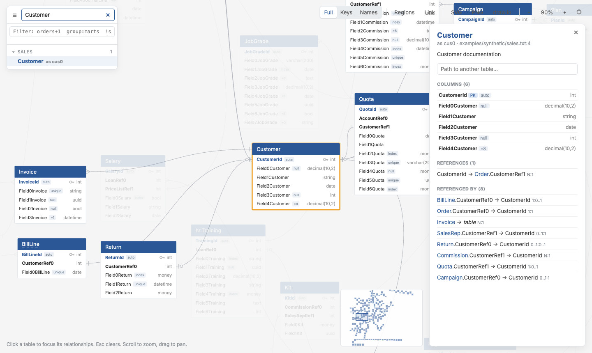
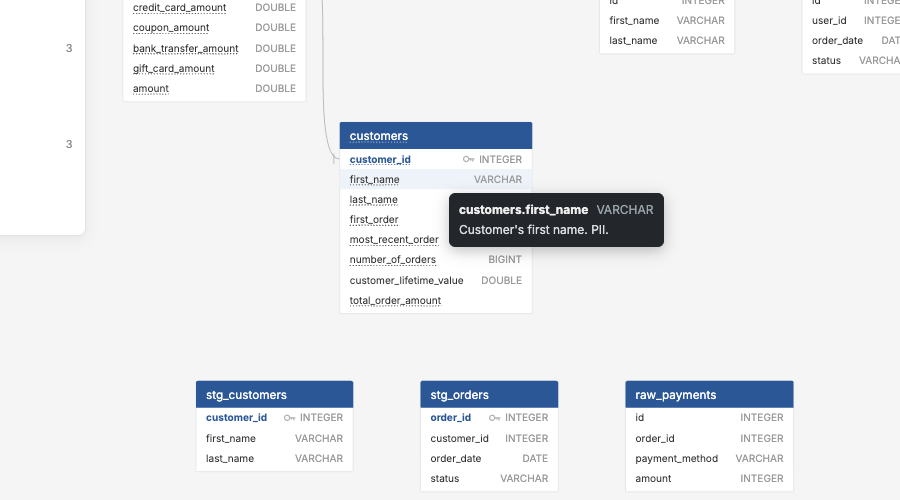
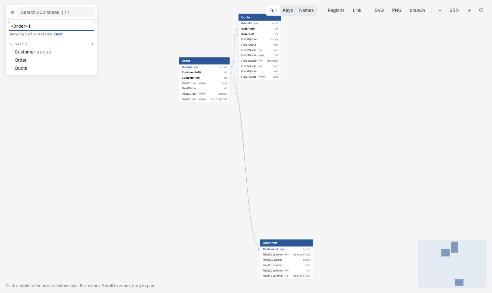
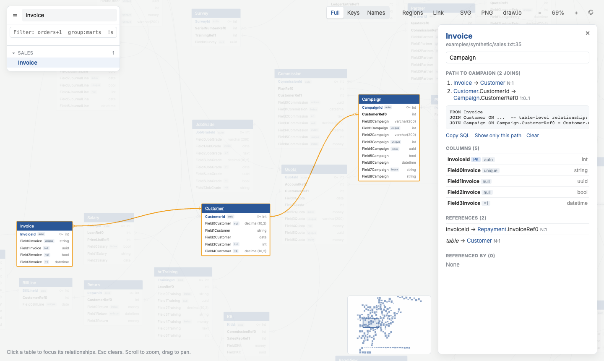
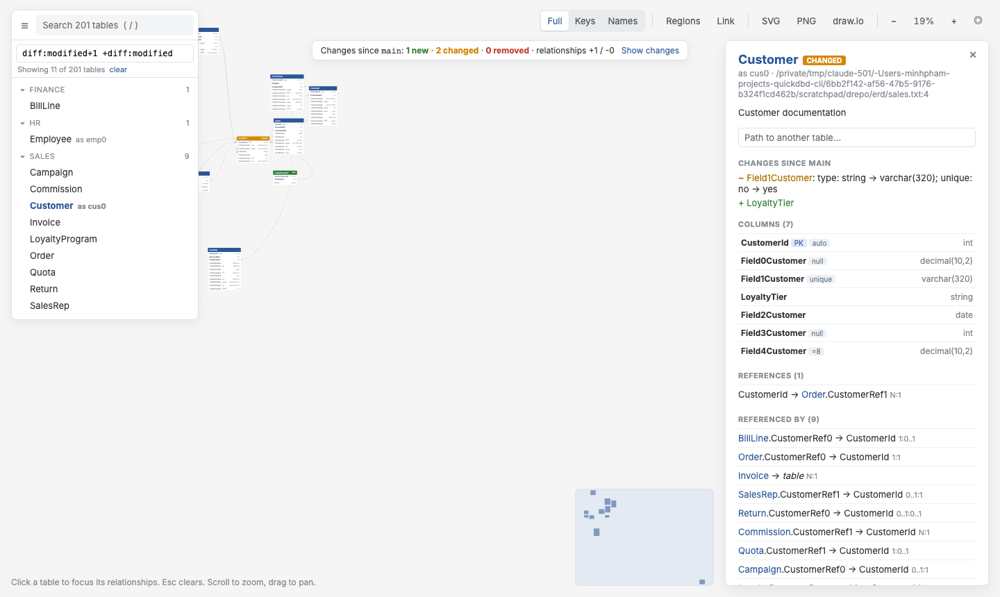

# 4.1 Reading the Diagram

Every `qdbd build` and `qdbd serve` page has the same layout: an **explorer** on the left, the **canvas** in the middle, the **toolbar** top right, and a **details panel** that opens on the right when you select a table.

{ .shot }

## Tables

| Element | Meaning |
|---|---|
| Blue header | Table name (aliases appear in the explorer and details). Another colour means the table has a [tag](tags.md) |
| **Blue bold** column + key icon | Primary key |
| **Bold** column | Foreign key, or a column used by a relationship |
| Grey text, right-aligned | Column type |
| Small grey tags | `auto` (IDENTITY), `unique`, `index`, `null` (nullable), `=value` (default) |
| Dotted underline | Has a doc comment: hover to read it |

Columns are **NOT NULL** unless tagged `null`, as in QuickDBD.

{ .shot }

## Relationship lines

Lines run from column to column; a table-level relationship attaches to the header. The ends show cardinality:

| End | Meaning |
|---|---|
| Short bar | exactly one |
| Crow's foot | many |
| Bar + circle | zero or one |
| Crow's foot + circle | zero or many |

Hovering a column highlights its lines and the columns at the other end.

## Moving tables

Drag any table to rearrange the diagram; lines follow. In a built page or the live demo the new arrangement lasts until you reload. In [`qdbd serve`](#in-qdbd-serve) it's saved to the layout file. Drag empty space to pan.

## Explorer

The left panel lists every table, grouped by file (or by dbt folder after [`qdbd import dbt`](dbt.md)).

- **Search** with `/`: matches names, aliases and groups. Enter jumps to the best match.
- **Filter** with dbt-style [selectors](selectors.md): `orders+1`, `group:marts`, `!stg_*`. Only matching tables stay on the canvas, the explorer and the minimap.
- **Tags:** when tables have [tags](tags.md), a chip per tag sits under the filter. Click one to show only that tag.

{ .shot }

## Details panel

Click a table (on the canvas or in the explorer):

- **Description**, file and line.
- **Columns**: type, keys, tags and doc comments.
- **References**: the tables this one points to (its foreign keys).
- **Referenced by**: the tables pointing here.
- **Path to another table**: the shortest join path, highlighted on the canvas, with a ready SQL `JOIN`.

Esc, ×, or clicking empty canvas closes it.

{ .shot }

## Toolbar

| Control | What it does |
|---|---|
| **Full / Keys / Names** | Collapse tables: all columns, only key and relationship columns, or only names |
| **Regions** | Shade an area per file / dbt folder (shown when there's more than one) |
| **Link** | Copy a URL to this exact view: filter, selected table, path, collapse mode, regions, zoom and position |
| **SVG / PNG / draw.io** | Download what's on screen ([exports](exports.md)) |
| **− 100% + ◎** | Zoom, or fit everything on screen |

The minimap (bottom right) shows where you are; click or drag it to move.

## Regions

When a schema has several files or dbt folders, **Regions** draws a labelled, coloured area behind each group. They read best with `--by-group`, which arranges each group together ([3.3 Table Positions](layout.md)).

{ .shot }

## Changes since a branch

Pages built with `--diff-base origin/main` mark what changed:

- **NEW** tables have a green header, **CHANGED** tables an amber header;
- changed and added columns get a coloured bar;
- a banner summarises the changes, and **Show changes** filters to them plus their neighbours;
- the details panel lists every change, including removed columns.

See [6. Reviewing Changes](diffs.md).

{ .shot }

## In `qdbd serve`

The live editor adds:

- an editor pane with one tab per file (autosaves 1 s after you stop typing) and an error panel;
- dragged positions are **saved** to the layout file;
- if a file changes on disk while you have unsaved edits, a banner lets you keep yours or reload.
