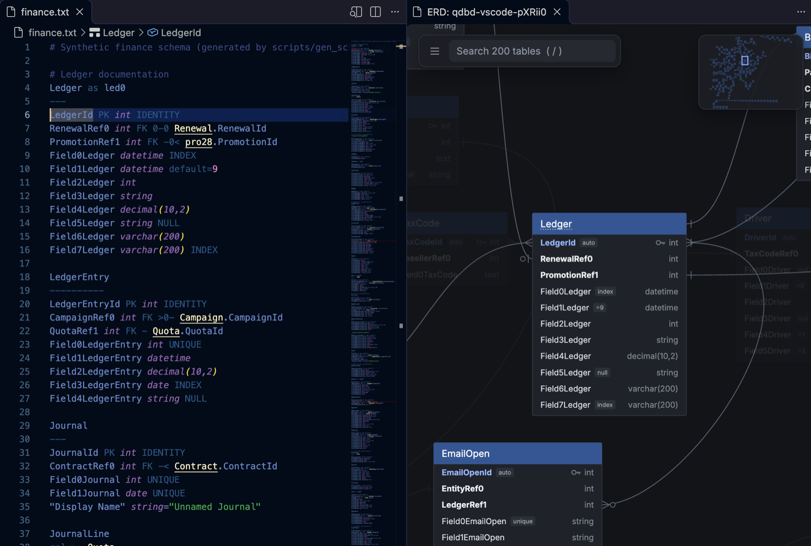

# 3.5 Editing in VS Code

The **QuickDBD (qdbd)** extension brings `qdbd` into VS Code, Cursor, Windsurf and VSCodium:

- syntax highlighting for QuickDBD files
- errors and warnings as you type, before you save
- an outline of tables and columns, and **F12** from a foreign key to the table it points at, across files
- the interactive diagram beside the editor, following your cursor



## Install

1. Install the CLI, version 0.1.16 or later. The extension runs it for every check and for the diagram.

    ```bash
    uv tool install quickdbd-cli      # or: pipx install quickdbd-cli
    ```

2. Install the extension: open the Extensions view (**Cmd+Shift+X** / **Ctrl+Shift+X**), search **QuickDBD** and pick **QuickDBD (qdbd)** by Minh Pham. It's on the [VS Code Marketplace](https://marketplace.visualstudio.com/items?itemName=MarkPhamm.quickdbd) and, for Cursor, Windsurf and VSCodium, on [Open VSX](https://open-vsx.org/extension/MarkPhamm/quickdbd). From a terminal:

    ```bash
    code --install-extension MarkPhamm.quickdbd     # or: cursor --install-extension MarkPhamm.quickdbd
    ```

Each [GitHub release](https://github.com/MarkPhamm/quickdbd-cli/releases/latest) also has the `.vsix` file, for **Install from VSIX…** in the Extensions view's **⋯** menu.

The extension looks for `qdbd` in the `quickdbd.qdbdPath` setting, then in the workspace's `.venv` (or `venv`), then on your `PATH`. If it can't find it, or the version is too old, it offers to run the install or upgrade command for you.

## Which files it opens as QuickDBD

QuickDBD files are plain `.txt`, so the extension decides by content. A `.txt` file opens as **QuickDBD** (shown at the right of the status bar) when either:

- it has a table (a name, then a `---` line) and a `PK`, `FK` or `rel` line, or
- a [layout file](layout.md) sits next to it: `qdbd.layout.json`, or `<name>.layout.json` for `<name>.txt`.

To turn this off, set `quickdbd.autoDetect` to `false`. To mark files yourself, use VS Code's own setting:

```json
"files.associations": { "**/erd/*.txt": "quickdbd" }
```

## Which files make up one schema

Foreign keys can point into other files, so the extension checks a file together with the rest of its schema, following the CLI's [layout file](layout.md) conventions:

1. `shop.txt` with a `shop.layout.json` beside it is checked on its own.
2. Otherwise, the nearest folder above it (inside the workspace) that holds a `qdbd.layout.json` is one schema, like `qdbd check that-folder/`.
3. Otherwise, the file's own folder, if every `.txt` file under it is a schema.
4. Otherwise, the file on its own, so a stray `notes.txt` doesn't break the check.

Opening the diagram writes `qdbd.layout.json` for a folder (or `<name>.layout.json` for a single file), so after the first preview, rule 1 or 2 applies.

## What you get

| Feature | How |
|---|---|
| **Errors as you type** | Squiggles and the Problems panel, from `qdbd check`. Unsaved text is checked against the other files on disk. Turn on `quickdbd.strict` to also fail on [QuickDBD-compatibility warnings](syntax.md#where-qdbd-is-more-forgiving). |
| **Outline** | The Outline view, breadcrumbs and **Ctrl+Shift+O** list tables and their columns. **Ctrl+T** finds a table in any open schema. |
| **Go to definition** | **F12** (or Ctrl/Cmd+click) on `Customer.CustomerId`, `rel >- Product` or an alias jumps to that table or column, in whichever file it is. |
| **Diagram** | **QuickDBD: Open Diagram to the Side** (**Cmd+K V** / **Ctrl+K V**, or the preview button at the top right of the editor). It's the same viewer as [`qdbd serve`](cli.md#serve), and it updates when you save. |
| **Follows your cursor** | Move the cursor into a table and the diagram selects it and pans to it. Click it there for its details. |
| **Back to the text** | Double-click a table in the diagram, or click its `file:line` in the details panel, to open it in the editor. |
| **Arrange** | Drag tables in the diagram; positions are saved to the layout file, as in `qdbd serve`. |
| **Theme** | The diagram follows VS Code's light or dark theme. |
| **Export and share** | **QuickDBD: Export PNG / SVG / draw.io** asks where to save. With the cursor in a table, you can export just that table and its neighbours. **QuickDBD: Share as a Gist Link** runs [`qdbd share`](sharing.md#qdbd-share) and copies the link. |

## Settings

| Setting | Default | |
|---|---|---|
| `quickdbd.qdbdPath` | empty | Path to `qdbd`. Empty: the workspace's `.venv`, then `PATH`. |
| `quickdbd.autoDetect` | `true` | Open matching `.txt` files as QuickDBD. |
| `quickdbd.strict` | `false` | Report QuickDBD-compatibility warnings as errors. |

## Troubleshooting

- **Nothing happens:** check the status bar says **QuickDBD**. If it says Plain Text, click it and pick QuickDBD, or add a `files.associations` entry.
- **"qdbd wasn't found":** run `qdbd --version` in a terminal. If that works there but not in VS Code, set `quickdbd.qdbdPath` to the full path (`which qdbd`).
- **Logs:** **View → Output**, then pick **QuickDBD** from the list.
- **Restricted mode:** the extension runs a program (`qdbd`), possibly from the workspace's virtualenv, so it stays off until you trust the workspace.
