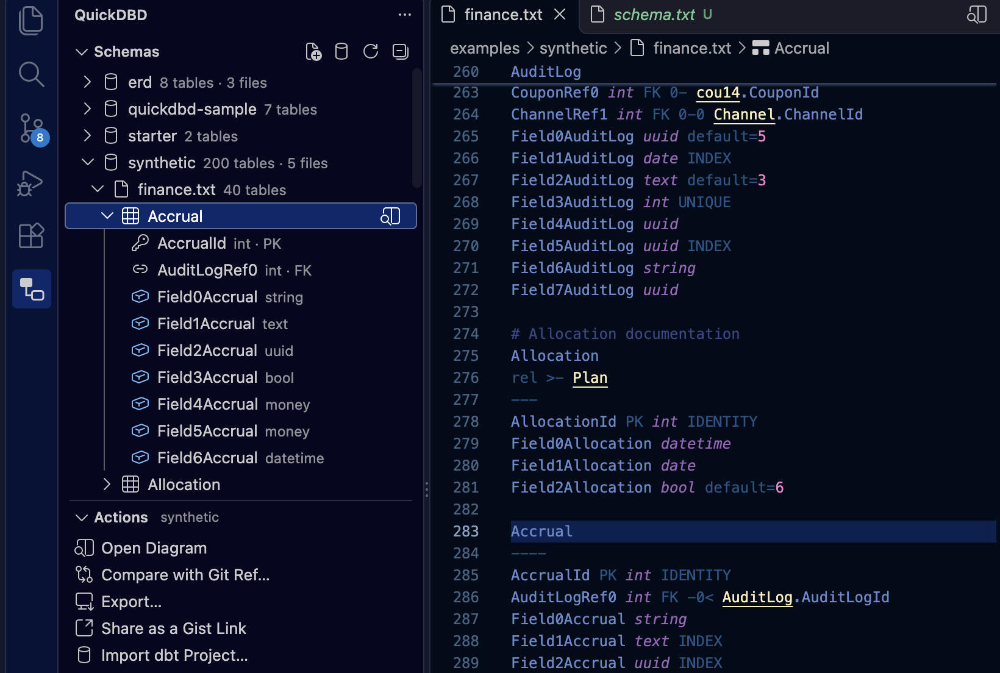

# 3.6 Editing in VS Code

The **QuickDBD (qdbd)** extension brings `qdbd` into VS Code, Cursor, Windsurf and VSCodium:

- syntax highlighting for QuickDBD files
- errors and warnings as you type, before you save
- an outline of tables and columns, and **F12** from a foreign key to the table it points at, across files
- the interactive diagram beside the editor, following your cursor
- a sidebar listing every schema in the workspace, down to its columns, with each action one click away
- export, share as a link, compare with a git branch, and import a dbt project

You never need a terminal: the extension installs the `qdbd` CLI it runs on.

**Get it:** [VS Code Marketplace](https://marketplace.visualstudio.com/items?itemName=MarkPhamm.quickdbd) (VS Code) · [Open VSX](https://open-vsx.org/extension/MarkPhamm/quickdbd) (Cursor, Windsurf, VSCodium)


## Install

1. Install the extension: open the Extensions view (**Cmd+Shift+X** / **Ctrl+Shift+X**), search **QuickDBD** and pick **QuickDBD (qdbd)** by Minh Pham. It's on the [VS Code Marketplace](https://marketplace.visualstudio.com/items?itemName=MarkPhamm.quickdbd) and, for Cursor, Windsurf and VSCodium, on [Open VSX](https://open-vsx.org/extension/MarkPhamm/quickdbd). Each [GitHub release](https://github.com/MarkPhamm/quickdbd-cli/releases/latest) also has the `.vsix` file, for **Install from VSIX…** in the Extensions view's **⋯** menu.
2. Open a schema file. The extension runs the `qdbd` CLI (version 0.1.17 or later) for every check and for the diagram. If it can't find one, it says so: click **Install qdbd**. It sets up a Python environment of its own and installs `qdbd` there, which takes about a minute. You can also run **QuickDBD: Install or Update qdbd** from the Command Palette at any time.

Installing needs Python 3.11 or later on the machine ([python.org](https://www.python.org/downloads/)), or [uv](https://docs.astral.sh/uv/), which downloads a Python by itself.

Which `qdbd` it uses:

1. The `quickdbd.qdbdPath` setting, if you set it.
2. The workspace's `.venv` (or `venv`), so a project can pin its version.
3. Otherwise, the newer of its own install and the `qdbd` on your `PATH`. If you already use the CLI (`uv tool install quickdbd-cli`), the extension uses that one and installs nothing.

A version that's too old is skipped, and the extension offers **Update qdbd**.

## The QuickDBD sidebar { #sidebar }

Click the **QuickDBD** icon in the Activity Bar (two boxes joined by a line).



**Schemas** lists every schema in the workspace, found the same way files are [opened as QuickDBD](#which-files-it-opens-as-quickdbd), without opening them:

- A **schema** shows its table count, its files and any errors. Hover it for **Open Diagram** and **Compare with Git Ref**; right-click it for the exports and **Share**.
- A schema made of several files lists them, then their tables. Click a **table** to open it in the editor (an open diagram follows), or hover it for **Show in Diagram**.
- A table lists its **columns**, with their types and a key icon for a primary key or a link icon for a foreign key. Click one to jump to its line.
- The buttons at the top create a **New Schema File** (a small starter schema, opened with its diagram), **Import a dbt Project**, or **Refresh** the list. It also updates by itself when schema files are added or deleted.

**Actions** has every command, one click each. They run on the schema named in the Actions header: the one in the active editor, else the one selected in Schemas. The last row shows the `qdbd` the extension runs and where it came from; click it to install or update.

With no `qdbd` yet, the sidebar shows an **Install qdbd** button; with no schema yet, **New Schema File** and **Import dbt Project**.

## Which files it opens as QuickDBD

`.dbml` files open as **DBML**, and get everything below too. A `.txt` file holding DBML (a `Table name {` or `Ref:` line) opens as DBML.

QuickDBD files are plain `.txt`, so the extension decides by content. A `.txt` file opens as **QuickDBD** (shown at the right of the status bar) when either:

- it has a table (a name, then a `---` line) and a `PK`, `FK` or `rel` line, or
- a [layout file](layout.md) sits next to it: `qdbd.layout.json`, or `<name>.layout.json` for `<name>.txt`.

To turn this off, set `quickdbd.autoDetect` to `false`. To mark files yourself, use VS Code's own setting:

```json
"files.associations": { "**/erd/*.txt": "quickdbd" }
```

## Which files make up one schema

Foreign keys can point into other files, so the extension checks a file together with the rest of its schema, following the CLI's [layout file](layout.md) conventions:

1. `shop.txt` with a `shop.layout.json` beside it is checked on its own.
2. Otherwise, the nearest folder above it (inside the workspace) that holds a `qdbd.layout.json` is one schema, like `qdbd check that-folder/`.
3. Otherwise, the file's own folder, if every `.txt` file under it is a schema (QuickDBD or DBML; `.dbml` files always are) and no layout file below it marks a separate project (like `examples/synthetic/` next to `examples/quickdbd-sample.txt`).
4. Otherwise, the file on its own, so a stray `notes.txt` doesn't break the check.

Opening the diagram writes `qdbd.layout.json` for a folder (or `<name>.layout.json` for a single file), so after the first preview, rule 1 or 2 applies.

## What you get

| Feature | How |
|---|---|
| **Errors as you type** | Squiggles and the Problems panel, from `qdbd check`. Unsaved text is checked against the other files on disk. Turn on `quickdbd.strict` to also fail on [QuickDBD-compatibility warnings](syntax.md#where-qdbd-is-more-forgiving). |
| **Outline** | The Outline view, breadcrumbs and **Ctrl+Shift+O** list tables and their columns. **Ctrl+T** finds a table in any open schema. |
| **Go to definition** | **F12** (or Ctrl/Cmd+click) on `Customer.CustomerId`, `rel >- Product` or an alias jumps to that table or column, in whichever file it is. |
| **Diagram** | **QuickDBD: Open Diagram to the Side** (**Cmd+K V** / **Ctrl+K V**, or the preview button at the top right of the editor). It's the same viewer as [`qdbd serve`](cli.md#serve), and it updates when you save. |
| **Follows your cursor** | Move the cursor into a table and the diagram selects it and pans to it. Click it there for its details. |
| **Back to the text** | Double-click a table in the diagram, or click its `file:line` in the details panel, to open it in the editor. |
| **Arrange** | Drag tables in the diagram; positions are saved to the layout file, as in `qdbd serve`. |
| **Theme** | The diagram follows VS Code's light or dark theme. |
| **Export** | **QuickDBD: Export PNG / SVG / draw.io** asks where to save. With the cursor in a table, you can export just that table and its neighbours. **QuickDBD: Export HTML Page** writes the whole interactive diagram as one file, like [`qdbd build`](cli.md#build), and opens it in your browser. |
| **Share** | **QuickDBD: Share as a Gist Link** publishes the diagram as a secret gist, like [`qdbd share`](sharing.md#qdbd-share), and copies the link. It signs in with VS Code's GitHub account (the first time, VS Code asks), so the `gh` CLI isn't needed. Sharing again updates the same gist, also one made by `qdbd share`, so the link stays the same. |
| **Compare with git** | **QuickDBD: Compare with Git Ref…** (the compare button at the top right of the editor) picks a branch, tag or commit and opens the diagram coloured by what changed since then, as in a [PR diff](diffs.md). It updates as you save. Pick **HEAD** to see what you haven't committed. |
| **Import dbt** | **QuickDBD: Import dbt Project…** turns a dbt project's `target/manifest.json` into schema files, like [`qdbd import dbt`](dbt.md), into `erd/` (one file per dbt folder) or one file you choose, then opens the diagram. Run `dbt compile` first; `dbt docs generate` adds column types. |
| **Convert** | **QuickDBD: Convert to DBML** / **Convert to QuickDBD Syntax**, from the editor or a schema's row in the sidebar, like [`qdbd convert`](dbml.md#convert). A one-file schema is written next to it; a folder schema into a new folder beside it. What the other syntax can't express is listed in the QuickDBD output channel. |

## Settings

| Setting | Default | |
|---|---|---|
| `quickdbd.qdbdPath` | empty | Path to `qdbd`. Empty: the workspace's `.venv`, else the newer of the extension's own install and the one on `PATH`. |
| `quickdbd.autoDetect` | `true` | Open matching `.txt` files as QuickDBD. |
| `quickdbd.strict` | `false` | Report QuickDBD-compatibility warnings as errors. |

## Troubleshooting

- **Nothing happens:** check the status bar says **QuickDBD**. If it says Plain Text, click it and pick QuickDBD, or add a `files.associations` entry.
- **"qdbd isn't installed":** click **Install qdbd**, or run **QuickDBD: Install or Update qdbd**. If you installed it yourself and VS Code doesn't find it, set `quickdbd.qdbdPath` to the full path (`which qdbd`).
- **"Installing qdbd needs Python 3.11 or later":** install Python from [python.org](https://www.python.org/downloads/), then run **QuickDBD: Install or Update qdbd**.
- **Compare says it can't read the ref:** the schema must be in a git repository, and the ref must exist locally (fetch first for `origin/main`).
- **Logs:** **View → Output**, then pick **QuickDBD** from the list.
- **Restricted mode:** the extension runs a program (`qdbd`), possibly from the workspace's virtualenv, so it stays off until you trust the workspace.
